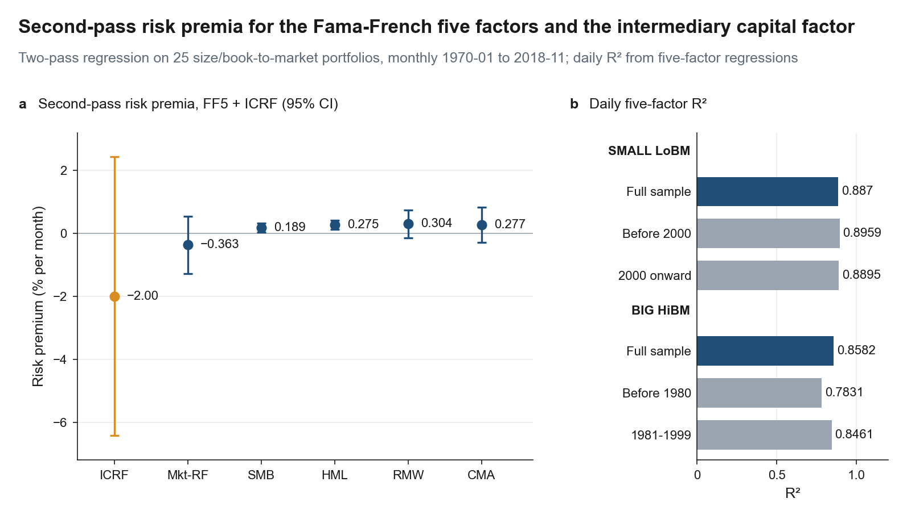

# Fama-French Five Factors and the Intermediary Capital Risk Factor

This project adds the He-Kelly-Manela intermediary capital risk factor (ICRF) to the Fama-French five factors (FF5) and asks whether it helps price the 25 size and book-to-market portfolios. In a monthly two-pass regression in R, 1970-01 to 2018-11, the estimated ICRF premium is not statistically different from zero (-2.0% per month with a standard error of 2.1%, t = -0.95). Adding the ICRF raises cross-sectional R² from 0.7107 to 0.7217 and lowers adjusted R² from 0.6345 to 0.629. The repo also runs daily five-factor regressions on two corner portfolios across sub-periods (R² between 0.7831 and 0.8959) and screens all six factors with a weighted Lasso.



## Results

All numbers are copied from the output files in `results/`.

### 1. Five-factor time-series regressions (daily)

Source: `results/01_five_factor_regression_output.txt`

| Portfolio / sample | N | Mkt-RF | SMB | HML | RMW | CMA | Intercept | R² |
|---|---|---|---|---|---|---|---|---|
| SMALL LoBM, full | 15,397 | 1.037 | 1.119 | -0.302 | -0.378 | 0.051 | -0.0032 (p = 0.378) | 0.887 |
| SMALL LoBM, years through 1999 | 9,192 | 1.148 | 1.206 | -0.247 | -0.172 | 0.073 | -0.0010 (p = 0.771) | 0.8959 |
| SMALL LoBM, years 2000 onward | 6,205 | 0.964 | 1.104 | -0.256 | -0.514 | 0.078 | -0.0114 (p = 0.117) | 0.8895 |
| BIG HiBM, full | 15,397 | 1.146 | -0.133 | 1.123 | -0.249 | -0.233 | 0.0110 (p = 0.0085) | 0.8582 |
| BIG HiBM, years through 1979 | 4,136 | 1.170 | -0.088 | 0.902 | 0.043 (p = 0.186) | -0.056 (p = 0.054) | 0.0079 (p = 0.230) | 0.7831 |
| BIG HiBM, years 1981 through 1999 | 4,803 | 1.162 | -0.117 | 1.049 | -0.013 (p = 0.568) | -0.161 | 0.0131 (p = 0.018) | 0.8461 |

Factor loadings without a p-value in parentheses have p < 0.001. Intercepts are in percent per day, the unit of the daily French factor and portfolio returns. Sub-periods are calendar years of the trading date. The RMW loading of SMALL LoBM is more negative after 2000 than before.

### 2. Two-pass regression, 25 portfolios, monthly 1970-01 to 2018-11

Source: `results/02_two_pass_regression_output.txt`

Second-pass estimates as printed by R. The FF5 factors and the portfolio returns are in percent per month and the ICRF series is in decimal units, so the ICRF estimate of -0.020 is a premium of -2.0% per month (standard error 2.1%):

| | FF5 + ICRF | FF5 only |
|---|---|---|
| Intercept | 0.938 (t = 2.04, p = 0.056) | 0.822 (t = 1.89, p = 0.074) |
| ICRF | -0.020 (t = -0.95, p = 0.356) | - |
| Mkt-RF | -0.363 (p = 0.414) | -0.274 (p = 0.519) |
| SMB | 0.189 (p = 0.015) | 0.210 (p = 0.005) |
| HML | 0.275 (p = 0.001) | 0.294 (p < 0.001) |
| RMW | 0.304 (p = 0.163) | 0.370 (p = 0.069) |
| CMA | 0.277 (p = 0.314) | 0.214 (p = 0.411) |
| R² | 0.7217 | 0.7107 |
| Adjusted R² | 0.629 | 0.6345 |

Standard errors are OLS standard errors from the second pass.

### 3. Weighted Lasso on the six factor betas

Source: `results/03_weighted_lasso_output.txt`, path plot in `results/03_lasso_path.pdf`

The script prints the full `glmnet` path (95 values of lambda, from 1.089 down to 0.00017). The number of factors with a non-zero coefficient grows from 0 to 6 along the path: 1 factor at lambda = 0.9924, 3 at 0.6840, 4 at 0.1860, 5 at 0.01374, and all 6 from lambda = 0.00374 onward. The deviance explained at the end of the path is 72.55%.

## Scripts

All scripts are run from the project root and read from `data/` with relative paths. Console output is written to `results/` with `sink()`, and figures are saved to `results/`.

| Script | What it does | Output |
|---|---|---|
| `01_five_factor_regression.R` | Daily time-series OLS of two corner portfolios (`SMALL LoBM`, `BIG HiBM`) on Mkt-RF, SMB, HML, RMW, CMA, for the full sample and for sub-periods by calendar year of the trading date (SMALL LoBM: years through 1999 / years 2000 onward; BIG HiBM: years through 1979 / years 1981 through 1999). Prints a stargazer LaTeX table for the SMALL LoBM models. | `results/01_five_factor_regression_output.txt` |
| `02_two_pass_regression.R` | Monthly data, 1970-01 to 2018-11. First pass: for each of the 25 portfolios, regress the excess return on the factors to get betas. Second pass: regress the 25 average excess returns on the betas. Done twice: FF5 + ICRF, and FF5 only. Also plots the ICRF against each FF5 factor. | `results/02_two_pass_regression_output.txt`, `results/02_icrf_vs_ff5_scatter.pdf`, `results/inter_vs_ff5.png` |
| `03_weighted_lasso.R` | Same first pass with all six factors, then a Lasso (`glmnet`, `alpha = 1`) of the 25 average excess returns on the six betas. Each factor's penalty weight is `(sum_i |z(partial corr_ij)|)^(-1.5)`, where `z` is the Fisher transform of the partial correlation between portfolio i's excess return and factor j. Prints and plots the full Lasso path. | `results/03_weighted_lasso_output.txt`, `results/03_lasso_path.pdf` |

## Data

Raw data are not included in this repository (`data/` is git-ignored). Download them from the original sources and place them in `data/` with the file names below.

| File in `data/` | Source | Used by |
|---|---|---|
| `F-F_Research_Data_5_Factors_2x3_daily.CSV` | Kenneth French Data Library, "Fama/French 5 Factors (2x3) [Daily]" | 01 |
| `25_Portfolios_5x5_Daily.csv` | Kenneth French Data Library, "25 Portfolios Formed on Size and Book-to-Market (5 x 5) [Daily]" | 01 |
| `F-F_Research_Data_5_Factors_2x3.xlsx` | Kenneth French Data Library, "Fama/French 5 Factors (2x3)" (monthly) | 02, 03 |
| `25_Portfolios_5x5.xlsx` | Kenneth French Data Library, "25 Portfolios Formed on Size and Book-to-Market (5 x 5)" (monthly) | 02, 03 |
| `He_Kelly_Manela_Factors_monthly.xlsx` | He, Kelly and Manela (2017), "Intermediary Asset Pricing: New Evidence from Many Asset Classes", *Journal of Financial Economics*; monthly factor file from the authors' data page | 02, 03 |

- Kenneth French Data Library: <https://mba.tuck.dartmouth.edu/pages/faculty/ken.french/data_library.html>
- He-Kelly-Manela factors: the authors' data page, linked from Asaf Manela's website (<https://asafmanela.github.io/>).

Expected layout of the files:

- The CSV files are the French library CSVs with the descriptive header lines removed, so that the first row holds the column names and the first column is named `date` (`YYYYMMDD`).
- The `.xlsx` files are the monthly French CSVs saved as Excel workbooks, again with the first row holding the column names and the first column named `date` (`YYYYMM`). The monthly value-weighted returns block must come first; the scripts keep the first rows (`ff5[1:700, ]`, `test25[1:1150, ]`) and then filter dates.
- The HKM workbook has columns `date` (`YYYYMM`), `intermediary_capital_ratio`, `intermediary_capital_risk_factor`, `intermediary_value_weighted_investment_return`, `intermediary_leverage_ratio_squared`. The ICRF is the third column.

## How to run

```sh
# from the project root, after placing the data files in data/
Rscript 01_five_factor_regression.R
Rscript 02_two_pass_regression.R
Rscript 03_weighted_lasso.R
```

Required packages and the versions used are listed in `R_packages.txt`. The results above were produced with R 4.4.1 on Windows.
